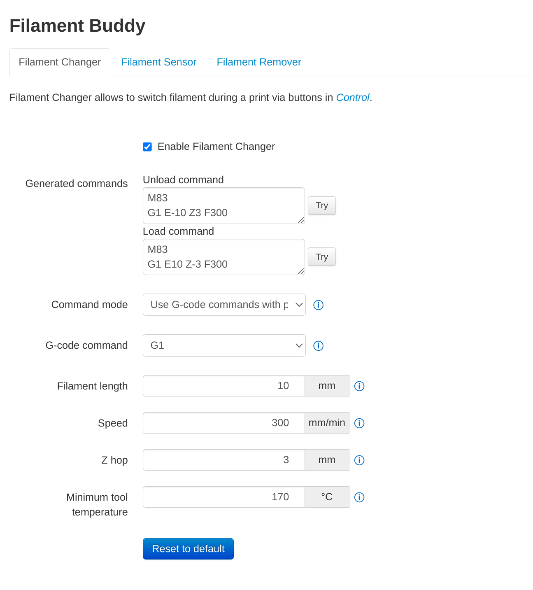
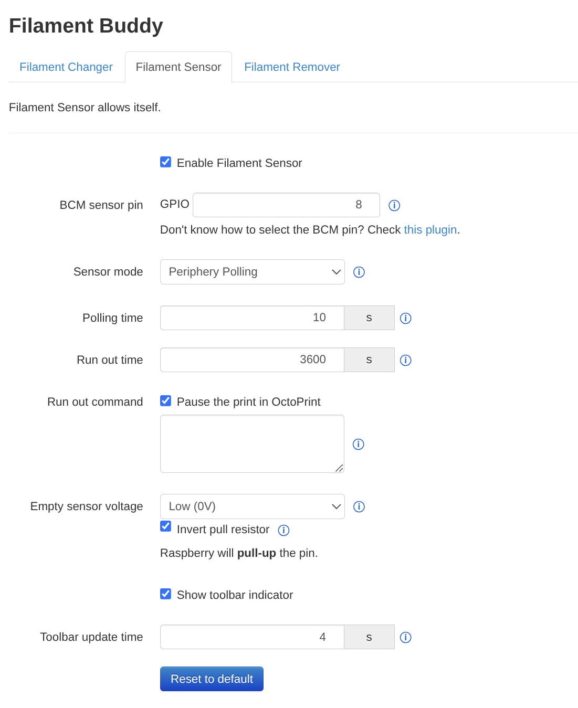
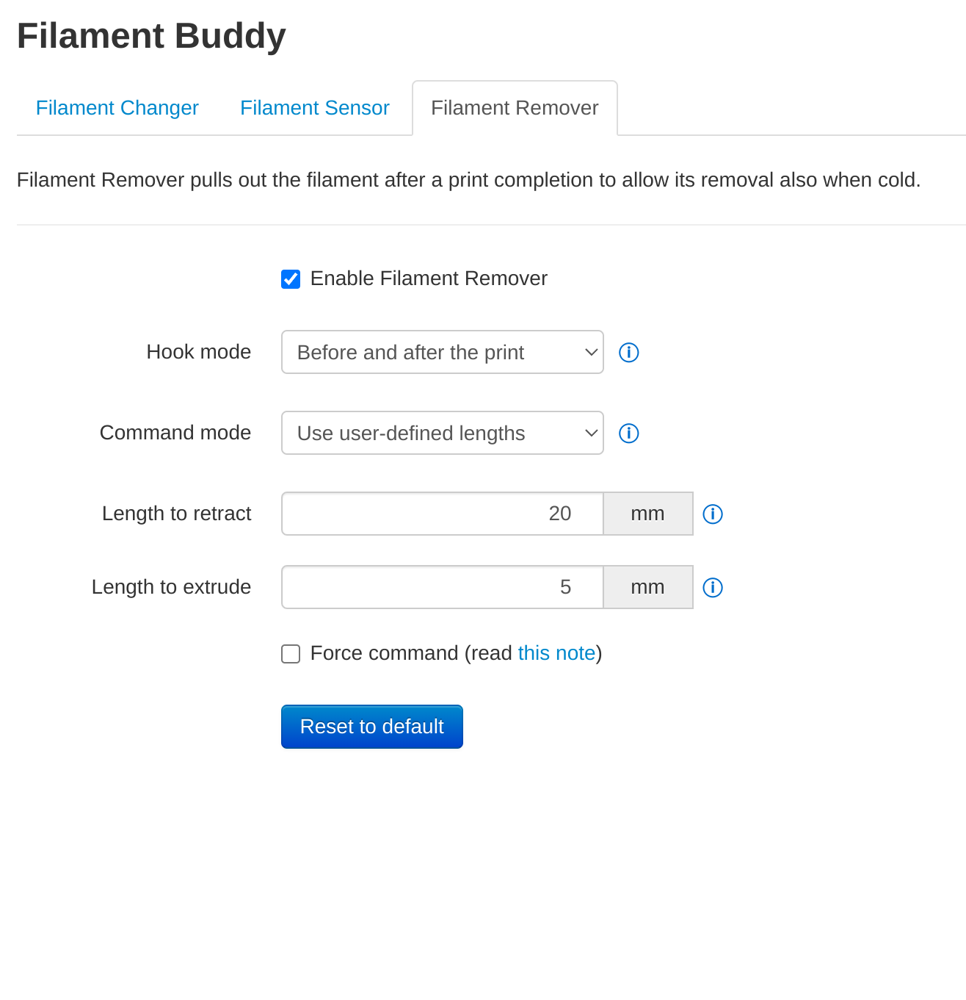
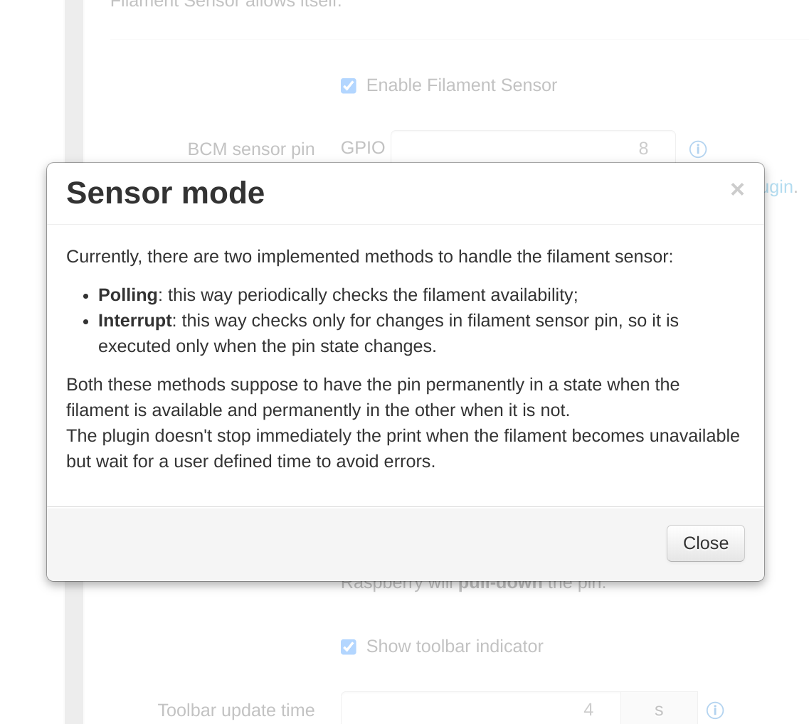

# FilamentBuddy

This plugin implements three independent features: filament change buttons,
a filament sensor manager, and automatic filament retraction when a print ends.
Each feature can be enabled or disabled separately.

## Features

### Filament Changer

Adds two buttons (_unload_ and _load_) to the OctoPrint _Control_ tab.
Pressing them sends a configurable G-code sequence to the printer. The
settings page offers three configuration modes:

- **Simplified** — choose a command type (G1, M600, or M701/M702) and the
  plugin generates the sequence automatically.
- **Complete** — same command types, but with full control over length, speed,
  Z-hop, and park position.
- **Custom** — write the G-code lines directly, one per line.

The unload button enforces a minimum tool temperature check before sending
commands; if the nozzle is below that threshold, a warning is shown and the
command is not sent. The load button has no temperature check. Neither button
works while a print is in progress.

The settings page shows a live preview of the generated G-code and provides
_Try_ buttons to send the current sequence to the printer directly from settings.

### Filament Sensor

Monitors a GPIO pin connected to a binary filament runout sensor. When the
filament is detected as absent during a print, the plugin waits for a
configurable confirmation period before pausing the printer, to avoid false
triggers caused by loose connections or brief signal noise.

The sensor is active only while printing: it starts automatically when a print
begins, stops when the print is paused, and resumes when the print is resumed.
If the filament is already absent at print start, a warning notification is
sent immediately and the runout timer begins.

Key parameters:

- **Polling time** — how often the GPIO pin is read, in seconds. Lower values
  give faster detection but increase CPU and GPIO load. The default (10 s) is
  a reasonable starting point.
- **Run out time** — once a missing filament is first detected, how long (in
  seconds) the plugin waits before actually pausing the print. If the filament
  returns within this window (e.g. the sensor briefly lost contact), no action
  is taken. This is the main protection against false positives.
- **Empty voltage** — the logic level the pin is at when filament is _absent_:
  LOW or HIGH. This depends on the specific sensor hardware.
- **Invert pull** — by default, the internal pull resistor is set to oppose the
  empty voltage (e.g. pull UP when empty=LOW, so the pin sits HIGH when
  filament is present). Check _Invert pull_ when an external pull resistor is
  already on the circuit and conflicts with the internal one.

The feature also provides:

- A toolbar indicator showing live filament presence.
- An optional MQTT notification when the filament runs out.

Supported sensor backends: **Periphery** (`p_polling`) and
**Adafruit Blinka** (`b_polling`). Both require a GPIO-capable board.

> **Raspberry Pi GPIO voltage:** the GPIO pins operate at **3.3 V**. Never
> connect a sensor that outputs 5 V directly to a GPIO pin without a level
> shifter. Always verify wiring before powering the board.

### Filament Remover

Automatically retracts the filament when a print ends, fails, or is cancelled,
so the nozzle does not cool down with filament still loaded. It can also
extrude a configurable length of filament just before a print starts, to prime
the nozzle.

Two trigger modes are available:

- **Outside** — retraction runs immediately after the last G-code line; insertion
  runs immediately before the first.
- **Temperature** — insertion is triggered once the nozzle reaches a minimum
  temperature (useful when the printer heats up as part of the start sequence),
  and retraction is triggered when the target temperature is set to 0 °C (the
  standard end-of-print cooldown command).

It supports simplified and custom command modes, and the _Force cold extrusion_
flag if needed.

---

## Requirements

| Requirement | Notes |
|---|---|
| OctoPrint ≥ 1.8.0 | Tested primarily with recent releases |
| Python ≥ 3.7 | Python 2 is not supported |
| `paho-mqtt` ≥ 1.6.1 | Always installed; required for MQTT notifications |
| Raspberry Pi or GPIO-capable board | Required for Filament Sensor only |
| `python-periphery` | Required for the `p_polling` sensor mode |
| `adafruit-blinka` + platform packages | Required for the `b_polling` sensor mode |

The Python packages listed above are declared as optional dependencies and are
installed automatically by the OctoPrint plugin manager. However, Adafruit
Blinka requires additional OS-level setup (see below).

**Filament Changer** and **Filament Remover** work on any board and any
printer that accepts Marlin-compatible G-code (or with a custom command
sequence for non-Marlin printers).

---

## Installation

Install via the bundled
[Plugin Manager](https://docs.octoprint.org/en/master/bundledplugins/pluginmanager.html)
or manually using this URL:

    https://github.com/danieleborgo/OctoPrint-FilamentBuddy/archive/master.zip

On first startup, all three features are disabled. A notification will prompt
you to open the settings page and configure what you need.

In some configurations, some parameters cannot be used, consequently
there is a mechanism to hide the values that the user cannot set, to
avoid confusion.

## Troubleshooting

### Filament Sensor is greyed out or disabled

The plugin automatically disables the Filament Sensor section if it cannot
detect a GPIO-capable environment. Check the following:

- OctoPrint is running on a Raspberry Pi or equivalent GPIO board.
- The OctoPrint user is in the `gpio` group (see GPIO setup above).
- The required GPIO library (`periphery` or `adafruit-blinka`) is installed
  and importable in OctoPrint's Python environment.
- For the Blinka backend: the `lgpio` or `pigpio` daemon is running
  (`systemctl status pigpiod`).

### "GPIO library unavailable" notification on startup

The sensor mode is set to a backend whose library could not be imported.
Either install the missing library or switch to the other backend in settings.

### Filament sensor triggers immediately / never triggers

1. Check the **Empty voltage** setting matches your sensor's datasheet: it
   should be the logic level present on the pin when no filament is loaded.
2. If the pin floats when the sensor is disconnected, toggle **Invert pull**
   and observe whether the toolbar indicator changes.
3. Use a multimeter or a GPIO inspection tool to confirm the actual pin
   voltage in both sensor states before adjusting software settings.

### Print pauses immediately at start

The filament is detected as absent before the print begins. The toolbar
indicator (if enabled) shows the live state. Check wiring continuity and
verify the **Empty voltage** polarity.

### Filament Changer / Remover does not move the extruder

Some Marlin firmware versions reject extrusion commands when the nozzle
is below a temperature threshold, even if it is warm enough in practice.
Enable the **Force cold extrusion** flag in the relevant settings section;
this sends `M302 P1` before the movement commands to disable the check.

### MQTT test button shows no response

- Verify the broker address, port, and credentials in settings.
- Confirm the broker is reachable from the Raspberry Pi:
  ```bash
  mosquitto_pub -h <broker-address> -t test -m hello
  ```
- Check the OctoPrint log (`~/.octoprint/logs/octoprint.log`) for connection
  error messages from FilamentBuddy.

---

## Help buttons


Almost every parameter in the settings page has an information button next to
it. Clicking it opens a description of what that parameter does and how it
interacts with the rest of the configuration.

---

## For developers

The filament sensor is designed to be extensible. The abstract class
`GenericFilamentSensorManager` defines the interface the plugin uses:

```
GenericFilamentSensorManager          (abstract, thread pool, logging)
  └── AbstractPollingFilamentSensorManager  (abstract, polling loop, runout timer)
        ├── PeripheryPollingFilamentSensor  (Periphery backend)
        └── BlinkaPollingFilamentSensor     (Adafruit Blinka backend)
```

To add a new backend, extend `AbstractPollingFilamentSensorManager` and
implement `is_currently_available()` and `_close_sensor()`, then register
the new class in `__initialize_filament_sensor()` in `__init__.py`.

---

## FAQ

#### Can I use just one or two of the three features?

Yes. Each feature has its own enable toggle in settings. Disabled features
have no runtime overhead.

#### I do not know what a parameter does — where do I look?

Click the information button next to the parameter in the settings page.

#### Can I use this plugin with a non-Marlin printer?

Filament Changer and Filament Remover work with any printer: set the command
mode to _Custom_ and write the appropriate G-code for your firmware.
Filament Sensor only requires OctoPrint's pause function and a configurable
G-code snippet, so it is also firmware-agnostic.

#### Which filament sensors are supported?

Any sensor that outputs a binary digital signal (one level = filament present,
other level = filament absent). Configure **Empty voltage** to match which
level means absent. The sensor must be compatible with 3.3 V GPIO logic.

#### How do I find the BCM pin number for my board?

BCM pin numbers are the ones labelled `GPIOxx` in the Raspberry Pi pinout.
The [GPIO Status plugin](https://plugins.octoprint.org/plugins/gpiostatus/)
can display them directly in OctoPrint. Alternatively, refer to the official
[Raspberry Pi pinout](https://www.raspberrypi.com/documentation/computers/raspberry-pi.html).

#### Why do some settings disappear when I change a mode?

The plugin hides parameters that do not apply to the currently selected mode
to reduce clutter. Switching modes may reveal or hide additional fields.

#### Which are the hardware limitations?

See [Requirements](#requirements) and [GPIO setup](#gpio-setup-filament-sensor-only).

#### Why do filament changer or remover not work?

Some Marlin printers may have a check regarding the temperatures before
moving the extruder. So if the nozzle temperature, or the bed one, are
lower than a predefined threshold, the commands for the extruder are
not executed. Since, in some cases the printer is still hot enough to
perform these operations, it is possible to disable this check through
the command _M302 P1_. For these cases, check the flag _Force Command_
in their settings page.


## Screenshots

More images available [here](images/).

#### Filament Changer settings



#### Filament Sensor settings



#### Filament Remover settings



#### Help window



---

## License

This software is distributed under GPLv3.0. See
[LICENSE.md](https://github.com/danieleborgo/OctoPrint-FilamentBuddy/blob/master/LICENSE)
for the full text.
